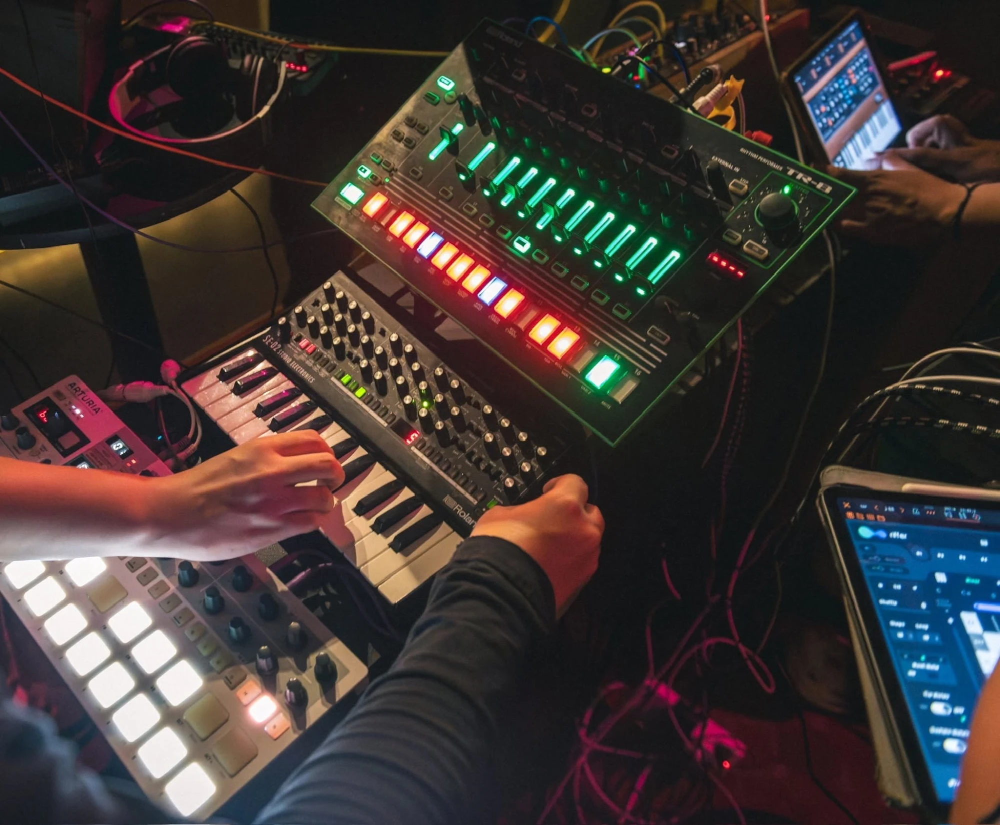

Mỗi ngày có khoảng 60.000 bản nhạc do AI tạo ra hoàn toàn (không do con người sáng tạo ra) được tải lên Deezer, chiếm hơn 1/3 tổng số lượng nhạc mới được đăng tải mỗi ngày trên toàn thế giới, tăng 400% chỉ trong vòng một năm. Cùng lúc đó, 97% người được khảo sát không phân biệt được đâu là nhạc AI, đâu là nhạc do con người viết (dữ liệu từ Deezer).

Tôi khá nhạy trong việc phát hiện ra được nhạc AI, còn nghe ra được model nào generate ra bản nhạc đó cơ, chắc vì cũng nghe nhiều nhạc mỗi ngày và có hoạt động sản xuất âm nhạc. Âm thanh của nhạc AI đầy đặn, sản xuất hoàn hảo, đúng thị hiếu, không có gì để phàn nàn, nhưng cũng không có gì đọng lại nhiều.

Chúng ta đang sống trong thời đại mà âm nhạc được tối ưu để không bị tắt. Không phải để được nhớ. Không phải để thay đổi ai. Chỉ cần tối ưu để thuật toán tiếp tục chạy.

Tôi làm sếp bé tại một công ty ứng dụng và đào tạo AI (công ty chữ i giấu tên), tôi dùng AI cho công việc hàng ngày và AI tạo sinh, đào tạo AI cơ bản, tôi có trợ lý AI cá nhân nhắc việc ơi ới hàng ngày. Hàng ngày tôi nghe trên dưới 100 chữ “ây ai” “ây ai” “ây ai” ở văn phòng. Tôi nhìn thằng cu nhân viên marketing cắm nối những node N8N và Make để phân tán hàng trăm content đi mọi nền tảng hàng ngày, cái hệ thống đó làm tôi nhớ đến những nhạc cụ điện tử (synth module và drum machine,...) được cắm nối với nhau bằng dây cáp trên chiếc bàn tròn ở quán Otto bar mỗi tối thứ 6 trong buổi synth jam của nhóm OPEN (tôi là 1 trong 4 thành viên). Tôi nghĩ: giờ mà cho thằng cu này đi Otto cắm synth chơi nhạc chắc nó thích lắm nhỉ?

Tôi nhớ đến mấy người bạn chơi nhạc cùng tôi, họ đều lớn hơn tôi kha khá, có anh Derek Bùi còn bằng tuổi sếp tổng công ty tôi. Mỗi tối thứ 6 cách tuần, nhóm OPEN chúng tôi đứng trước một chiếc bàn bày bừa những chiếc mini synthesizer, modular rack, loop station và tạo ra âm nhạc ngay lúc đó ở quán Otto Bar, trong lúc khách ở quán đang uống rượu và trò chuyện. Không có file nhạc chuẩn bị sẵn, không có cấu trúc cố định, không có nút Ctrl Z, thậm chí không trò chuyện với nhau, chỉ báo nhau key và tempo. Mỗi quyết định phải đưa ra trong vài mili giây, xoay một cái knob, cắm một sợi cáp, đều có hệ quả ngay lập tức và không thể undo.

Tôi vừa chơi vừa nghĩ: đây là thứ AI không thể làm được!

Tôi cũng đã thử generate nhạc chúng tôi chơi bằng Suno AI với đoạn prompt rất chi tiết của tôi. Kết quả nó trả cho tôi là một bản soft EDM vocal nữ mixing rất hay nhưng nhìn chung thì nghe rất mid và tất nhiên là không đúng ý tôi. Không phải vì AI thiếu kỹ thuật và nhạc lý, mà vì mục đích của cả hai hoàn toàn khác: một bên theo đuổi con số hoàn hảo, một bên theo đuổi cảm xúc tập thể của khoảnh khắc hiện tại mà bỏ qua lỗi lầm, chúng tôi biết việc bạn biết rằng những nghệ sĩ đứng trước mặt mình đang thật sự tạo ra thứ bạn đang nghe, ngay lúc này, và sẽ không bao giờ tạo ra y chang- một - lần - nào - nữa.

Ở Hà Nội vẫn luôn có những nhóm chơi nhạc như vậy và những cá nhân hoạt động ngầm như vậy, nhưng giữa bọn họ chưa có sự kết nối với nhau, chưa được biết tới, như những chiếc synthesizer chưa được cắm nối với nhau trong bóng đêm.

Vậy nên tôi sáng lập nên NÓB Network, mạng lưới (có thể là) đầu tiên, tập hợp các nghệ sĩ Live Electronic tại Việt Nam. Không phải để làm thêm một cái record label, không phải để xây một kênh truyền thông mà ưu tiên quảng bá những nghệ sĩ vung tiền cho họ, mà là để đặt nền móng cho một thứ đang lơ mơ tồn tại nhưng chưa có tên. Để những người nghệ sĩ nhạc điện tử có thêm chỗ để chơi, để những người cần tìm nghệ sĩ biết họ chơi ở đâu.

Ngày 20 tháng 3, NÓB Network chính thức ra mắt.

Tên sự kiện là NÓB: INIT, lấy cảm hứng từ ‘preset INIT’ trong các nhạc cụ synthesizer hiện đại, là điểm khởi nguồn để người chơi nhạc nhào nặn ra một âm thanh mới, khởi đầu cho những bản nhạc họ tự hào bắt đầu từ con số 0. Quy Trong Do chơi modular synth. TuanSS chơi live looping và beatbox. OPEN Project chơi synth jam. Và trước đó, chiếu dự án live session mang tên TESTRUN của Corrupted Moonlight, một dự án mà NÓB đã thực hiện trước khi NÓB thành hình.

Tôi luôn được học là content dài ngoằng như này sẽ không tối ưu cho mọi nền tảng trong thời đại ngày nay. Nhưng nếu bạn đã đọc đến đây, thì tôi dành hết sự tôn trọng dành cho bạn, và

Otto Bar, 18 Thanh Niên. 19h00 ngày 20/3 nhé.
